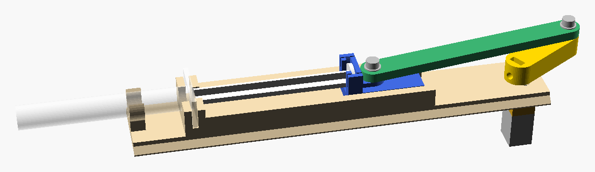

# Syringe Actuator

> A 3D-printed crank mechanism that drives a syringe plunger back and forth from a continuously
> running gearmotor.

[](https://github.com/uwo-fast/syringe-actuator/blob/main/LICENSING.md)
[](https://github.com/uwo-fast/.github/blob/main/CONTRIBUTING.md)



## Overview

An N20 gearmotor drives 1–5 mL luer syringes, and a 25 mm GA25 gearmotor drives 10–30 mL syringes.
Both run directly from a DC supply. A printed crank and connecting rod move the plunger through
nearly its full stroke, with the plunger clip running on rails. The mechanism sits in a printed
body. The syringe loads through a window in the roof with a lid, the two motor wires exit at the
back, and two patterns of knockout holes are provided for mounting. The only purchased hardware is
the syringe, the motor and a few screws.

**Status:** working prototype. [`docs/design.md`](docs/design.md) lists what has been printed and
run, and documents the mechanism, the part dimensions and their sources, and the open questions.

## Build one

1. **Choose the syringe.** Each syringe has its own frame, clip, crank and rod. The N20 syringes
   share one body, lid and cap, so switching between them means reprinting only those four parts.
   Presets:

   | Syringe | Motor | Source |
   | --- | --- | --- |
   | 1, 3, 5 mL (two makes of 5 mL) | N20 | measured unbranded luer-lock syringes |
   | 5 mL, both makes (`5ml-gnr1-ga25`, `5ml-gnr2-ga25`) | GA25 | the same syringes on the larger motor |
   | 20 mL | GA25 | measured |
   | 10, 30 mL | GA25 | BD Plastipak, estimated to about a millimetre |

   Syringes of the same volume differ between makers. For any other syringe, or to replace an
   estimate, measure it and add it as a preset (see [`docs/measuring.md`](docs/measuring.md)).

2. **Export the parts.** `just build` writes the printed parts for every preset to
   `build/<syringe>/`. Alternatively, open `cad/main.scad` in OpenSCAD and select the syringe and
   the `part` in the Customizer. The parts are the frame, crank, rod, clip, cradle, body, lid and
   cap, plus an optional front plate. `ring_test` prints the snap ring for the syringe on its own,
   so you can test the fit first. It is not written to `build/`, but is available in the Customizer
   and from `just export`.

3. **Buy the hardware.** `openscad -D 'syringe="3ml"' -D 'part="report"' -o r.csg cad/main.scad`
   lists the hardware for a given syringe:

   | Part | For | What |
   | --- | --- | --- |
   | Gearmotor | 1 to 5 mL | N20, 12 V, about 30 rpm (1000:1), such as Pololu #3046 |
   | Gearmotor | 10 to 30 mL | GA25YN370 (also JGA25-370), 12 V, 30 rpm |
   | Motor screws | N20 | 2 x M1.6 x 3 flat head, JIS cross drive No. 0, such as McMaster 91305A002 |
   | Motor screws | GA25 | 2 x M3 x 4 button head (ISO 7380) |
   | Pin screws | all | 2 x M3 x 10 socket head, with 2 x M3 washers |
   | Cap screws | all | 2 x M3 x 10 |
   | Crank | all | 1 x M3 x 6 socket head and 1 x M3 square nut |
   | Cradle | all | 2 x M3 x 8 socket head; if the motor can move in it, 2 x M3 x 6 set screw, cup point, and 2 x M3 square nut |
   | Front plate (optional) | all | 4 x M3 x 10 socket head and 4 x M3 square nuts |
   | Threadlocker | all | blue (medium strength), on every motor and cradle screw |

4. **Print.** Use PLA or PETG, with no supports. The body prints standing on its front wall. It is
   242 mm tall for the N20 syringes and 223 to 313 mm for the GA25 syringes, so check your printer's
   build height first. The frame stops against the front wall, so that wall prints flat on the bed.
   Turn on elephant-foot compensation in the slicer, and use a brim, because the body is tall on a
   small footprint.

5. **Assemble.**
   - **Motor:** screw the motor to the underside of the plate first, with threadlocker. Its shaft
     comes up through the plate, and the crank is fitted afterwards.
   - **Cradle:** slide the cradle up over the motor to the plate and screw it on from below. If the
     motor can move in the cradle, drop the square nuts into their slots and tighten the set screws
     until the gearbox cannot move. Tighten them again after the first day of running, as the print
     settles.
   - **Crank:** drop the nut into its slot, press the crank onto the motor shaft through the plate,
     and tighten the M3 screw onto the flat of the shaft. Connect the rod to the crank and the clip
     with the pin screws and washers.
   - **Body:** fit any front mounting screws first (step 6). Then slide the frame into the body from
     the back, slide the lid onto its rails from the back, and screw on the cap.
   - **Syringe:** load the syringe through the window. The barrel snaps into the ring and the
     push-button snaps into the clip.
   - **Tune:** if the clip or the ring is too loose or too tight, change `grip` or `ring_grip` in
     the Customizer and reprint that part.

6. **Mount it**, if needed. Drill or punch out the knockouts you need. There are four in the front
   wall and four in the shoulders of the roof. Your adapter attaches to them with M3 screws, with
   the heads inside the body. Fit the front screws before the frame goes in. An adapter drawn in
   OpenSCAD can take its dimensions from the layout: `use <cad/main.scad>`, then
   `L = actuator("3ml")`. `front_x(L)` and `front_face(get(L, "body"))` give the outer face of
   the front wall, the body's `mount_front` and `mount_top` give the holes, and `tip_x(L)` gives the
   syringe tip once the syringe's `nozzle_l` is known. If nothing is mounted on the front, the
   optional `front_plate` closes the front against light. The same four screws pass through it from
   inside the body into nuts on the plate. Fit it after loading the syringe, because its hole only
   just clears the barrel.

## Using it from another project

Another OpenSCAD project can draw an adapter, or the actuator itself, from the layout with
`use <cad/main.scad>` at a tagged release. The public interface is:

| Name | What it gives |
| --- | --- |
| `actuator(name, motor = "auto")` | the layout for a preset by its name below; `motor` is `"auto"`, `"n20"` or `"ga25"` |
| `front_x(L)` | the x of the outer face of the front wall, which an adapter mounts against |
| `tip_x(L)` | the x of the front end of the syringe, where its `nozzle_l` is known |
| `front_face(get(L, "body"))` | the outline of the front wall in [y, z] |
| `get(L, "axis_z")`, `"syringe"`, `"body"` | the height of the syringe axis, the syringe row, the body spec |
| `get(L, "throw")` | the crank throw. Twice the throw is the stroke the crank drives: the syringe's `stroke` less 1 mm at each end |
| the body's `"mount_front"`, `"mount_top"`, `"end_t"`, `"x"` | the mounting holes, the front wall thickness, the [front, back] x of the inside |
| `body()`, `lid()`, `cap()` | the printed body, lid and cap, drawn from the body's spec |

The presets: `1ml`, `3ml`, `5ml-gnr1`, `5ml-gnr2`, `5ml-gnr1-ga25`, `5ml-gnr2-ga25`, `10ml`,
`20ml`, `30ml`. Renaming or removing a preset, or changing what one of these names returns, is a
breaking change. While the version is 0.x, a breaking change comes in a new minor version (0.2.0).
The dimensions of a preset can still change in any release when its syringe is re-measured, so pin
a tag, not `main`.

## Repository layout

- `cad/`: the OpenSCAD source. `main.scad` draws the assembly or any printed part, `purchased/`
  holds the syringes, motors and fasteners, and `parts/` holds the printed parts
- `docs/`: the design record and the measuring guide
- `tools/`: the mesh check used by `just test`, the geometry checks used by `just qa`, and the
  renderer used by `just render`

## Development

Tasks run through [`just`](https://github.com/casey/just). `just --list` shows them all.

```sh
just setup   # verify the toolchain: OpenSCAD, topiary
just check   # formatting, and every SCAD file evaluates cleanly; CI runs setup, check and test
             # when anything outside the docs changes
just test    # every printed part, for every syringe, exports as one closed solid
just build   # every syringe's printed parts to build/<syringe>/, stamped with the commit
just qa      # slivers, collisions over a turn and overhangs, for every syringe
just render  # the pictures listed in cad/views.tsv, to output/figures/<syringe>/
just render-parts  # every printed part on its own, in its print orientation
just render-stroke # one turn of the crank as an animated GIF
```

## Contributing

Contributions are welcome. [`CONTRIBUTING.md`](CONTRIBUTING.md) covers the scope, layout,
commands, conventions and workflow of this repository. The organization
[contribution guide](https://github.com/uwo-fast/.github/blob/main/CONTRIBUTING.md) covers the rest.

## Citation

If you use this project in your work, please cite it. Use the **Cite this repository** button on
GitHub, or see
[`CITATION.cff`](https://github.com/uwo-fast/syringe-actuator/blob/main/CITATION.cff).

## License

Copyright (c) 2026 Syringe Actuator and its contributors.

This project is free software: you may redistribute it and/or modify it under the terms of the GNU
General Public License as published by the Free Software Foundation, either version 3 of the
License, or (at your option) any later version. The parametric CAD source (`.scad`) is also
licensed under
[CERN-OHL-S-2.0](https://github.com/uwo-fast/syringe-actuator/blob/main/LICENSES/CERN-OHL-S-2.0.txt),
and the geometry, drawings and bill of materials generated from it under CERN-OHL-S-2.0 alone.
See [`LICENSING.md`](https://github.com/uwo-fast/syringe-actuator/blob/main/LICENSING.md) for what
applies where, and the organization [licensing
policy](https://github.com/uwo-fast/.github/blob/main/LICENSING.md) for why.

## Contact

Maintained by the [FAST research group](https://uwo-fast.github.io/). For research collaboration
inquiries, contact Dr. Joshua Pearce (<joshua.pearce@uwo.ca>).
