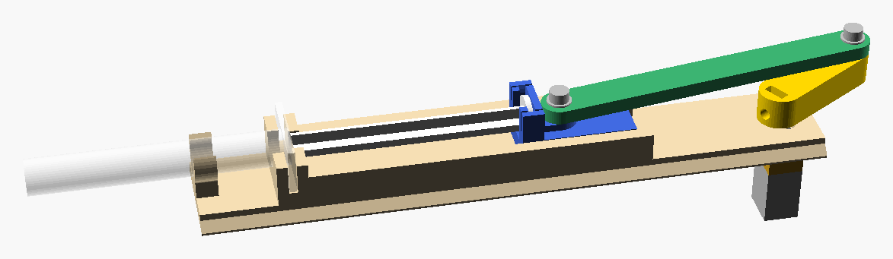

# Syringe Actuator

> A printed crank that drives a syringe plunger back and forth from a continuously running
> gearmotor.

[](LICENSING.md)
[](https://github.com/uwo-fast/.github/blob/main/CONTRIBUTING.md)



## Overview

A gearmotor runs in one direction straight off a supply: an N20 for 1 to 5 mL syringes, a 25 mm GA25
for 10 to 30 mL. A printed crank and connecting rod turn that into a continuous pull and push over
nearly the whole stroke of a luer syringe, the plunger's clip guided on rails. The mechanism sits in
a printed body: the syringe loads through a lidded window in the roof, the motor's two wires come
out the back, and two patterns of knockout holes take whatever you mount it to. The bought hardware
is the syringe, the motor and a few screws.

**Status:** working prototype. [`docs/design.md`](docs/design.md) records the mechanism, the part
dimensions and their sources, and what is open.

## Build one

1. **Pick the syringe.** The parts are built for one syringe at a time. Presets:

   | Syringe | Motor | Source |
   | --- | --- | --- |
   | 1, 3, 5 mL | N20 | measured unbranded luer-lock syringes |
   | 20 mL | GA25 | measured |
   | 10, 30 mL | GA25 | BD Plastipak, estimated to about a millimetre |

   Syringes of the same volume differ by maker, so for any other syringe, or to replace an estimate,
   measure it and add it as a preset: [`docs/measuring.md`](docs/measuring.md).

2. **Export the parts.** `just build` writes every preset's printed parts to `build/<syringe>/`, or
   open `cad/main.scad` in OpenSCAD and pick the syringe and the `part` in the Customizer. The parts
   are the frame, crank, rod, clip, body, lid and cap; `ring_test` prints the syringe's snap ring
   alone, to try it first.

3. **Buy the hardware.** `openscad -D 'syringe="3ml"' -D 'part="report"' -o r.csg cad/main.scad`
   lists it for a syringe:

   | Part | For | What |
   | --- | --- | --- |
   | Gearmotor | 1–5 mL | N20, 12 V, about 30 rpm (1000:1), such as Pololu #3046 |
   | Gearmotor | 10–30 mL | GA25YN370 (also JGA25-370), 12 V, 30 rpm |
   | Motor screws | N20 | 2 × M1.6 × 3 flat head |
   | Motor screws | GA25 | 2 × M3 × 4 button head (ISO 7380) |
   | Pin screws | all | 2 × M3 × 10 socket head, with 2 × M3 washers |
   | Cap screws | all | 2 × M3 × 10 |
   | Crank | all | 1 × M3 × 6 set screw, cup point (ISO 4026), and 1 × M3 nut |

4. **Print.** PLA or PETG, no supports. The body stands on its back end, 208 to 289 mm tall by
   syringe, so check your printer's height first; turn on the slicer's elephant-foot compensation
   and use a brim, since its rails start at the bed.

5. **Assemble.**
   - **Motor:** screw it under the plate first; the crank's hub covers its screws.
   - **Crank:** drop the nut into its slot, press the crank onto the motor's shaft through the
     plate, and tighten the set screw onto the shaft's flat. Join the rod to the crank and the clip
     with the pin screws over their washers.
   - **Body:** fit any front mounting screws first (step 6), then slide the frame into the body from
     the back, slide the lid onto its rails from the
     back, then screw on the cap.
   - **Syringe:** load it through the window: the barrel snaps into its ring and the push-button
     into the clip.
   - **Tune:** if the clip or the ring holds too loosely or too tightly, change `grip` or
     `ring_grip` in the Customizer and reprint that part.

6. **Mount it**, if you need to. Drill or punch out the knockouts you use: four through the front
   wall and four through the roof's shoulders. Your adapter screws to them, M3, with the heads
   inside the body; fit the front ones before the frame goes in. An adapter drawn in
   OpenSCAD can take its numbers from the layout: `use <cad/main.scad>`, then `L = actuator("3ml")`;
   `front_x(L)` and `front_face(get(L, "body"))` give the front wall's outer face, the body's
   `mount_front` and `mount_top` the holes, and `tip_x(L)` the syringe's tip, once the syringe's
   `nozzle_l` is known.

## Repository layout

- `cad/` — the OpenSCAD source: `main.scad` draws the assembly or any printed part,
  `purchased/` holds the syringes, motors and fasteners, `parts/` the printed parts
- `docs/` — the design record and the measuring guide
- `tools/` — the mesh check behind `just test`, and the geometry checks behind `just qa`

## Development

Tasks run through [`just`](https://github.com/casey/just); `just --list` shows them all.

```sh
just setup   # verify the toolchain: OpenSCAD, clang-format
just check   # what CI runs: formatting and every SCAD file evaluating cleanly
just test    # every printed part, for every syringe, exports as one closed solid
just build   # every syringe's printed parts to build/<syringe>/, stamped with the commit
just qa      # slivers, collisions over a turn and overhangs, for every syringe
```

## Contributing

Contributions are welcome. See the organization
[contribution guide](https://github.com/uwo-fast/.github/blob/main/CONTRIBUTING.md).

## Citation

If you use this project in your work, please cite it. Use the **Cite this repository** button on
GitHub, or see [`CITATION.cff`](CITATION.cff).

## License

Copyright © 2026 Syringe Actuator and its contributors.

This project is free software: you may redistribute it and/or modify it under the terms of the GNU
General Public License as published by the Free Software Foundation, either version 3 of the
License, or (at your option) any later version. Hardware design files and the outputs generated
from them are licensed instead under [CERN-OHL-S-2.0](LICENSES/CERN-OHL-S-2.0.txt). See
[`LICENSING.md`](LICENSING.md) for what applies where, and the organization
[licensing policy](https://github.com/uwo-fast/.github/blob/main/LICENSING.md) for why.

## Contact

Maintained by the [FAST research group](https://uwo-fast.github.io/). For research collaboration
inquiries, contact Dr. Joshua Pearce (<joshua.pearce@uwo.ca>).
